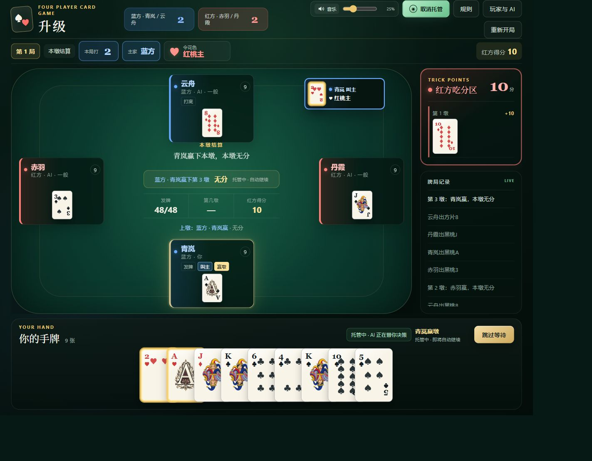
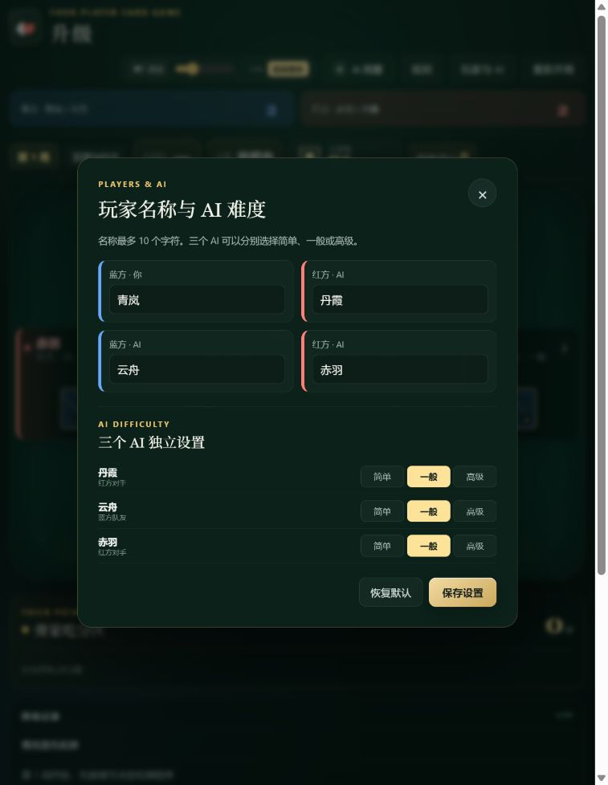
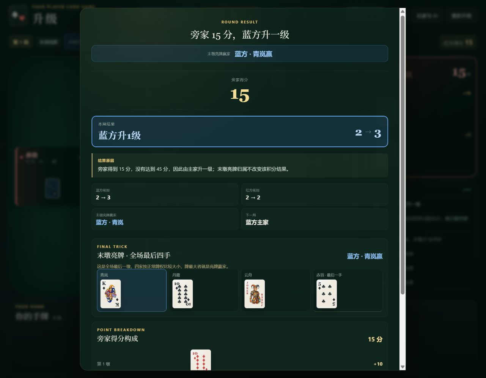
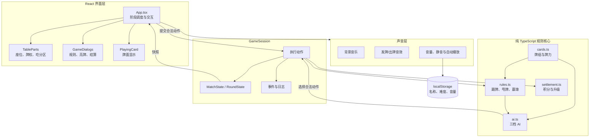
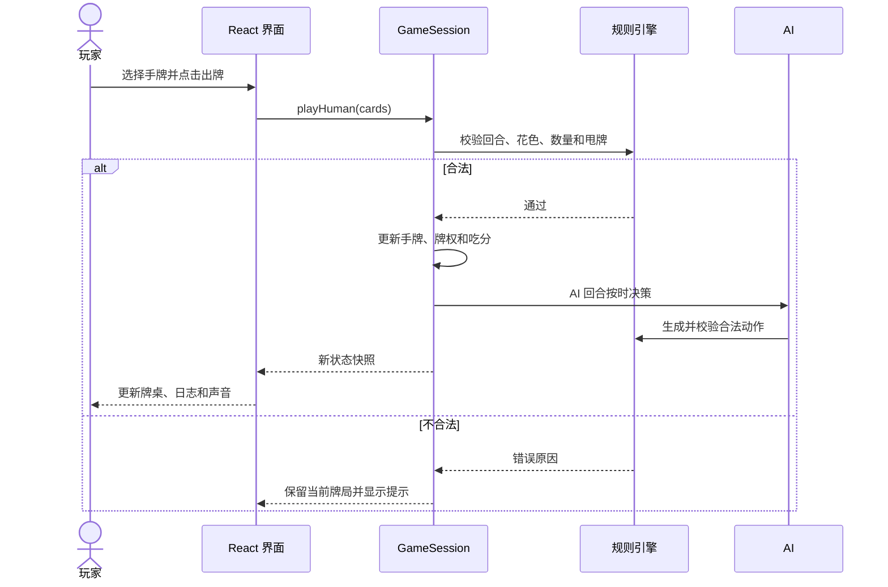
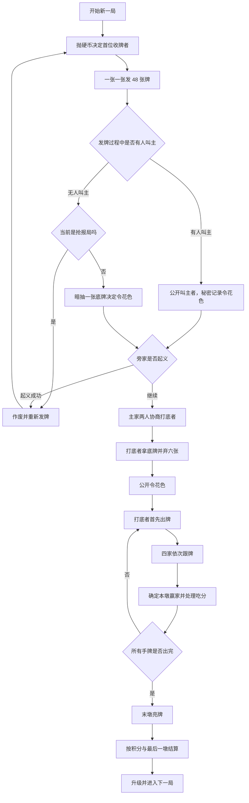
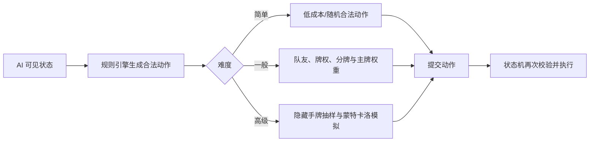
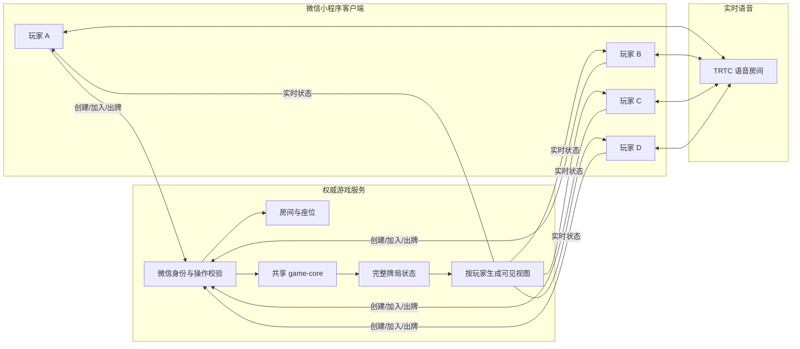

# 升级 · 四人扑克

一个可直接在浏览器运行的四人“升级”扑克游戏。玩家坐在蓝方，与三名可分别设置难度的本地 AI 连续对局。

项目目前是**单机网页版**，包含完整的发牌、暗令、起义、打底、甩牌、计分、升级与结算流程，并为后续微信小程序和四人联机保留了独立的规则层。

## 界面预览

### 牌桌与实时牌权



### 玩家名称与独立 AI 难度



### 本局结算、末墩亮牌与得分构成



## 功能

- 54 张标准牌组，每人 12 张，留 6 张底牌
- 一张一张发牌，公开叫主者，令花色保密到打底完成
- 每张可叫牌提供 5 秒决策时间，超时自动过
- 抢报、普通无人叫主、起义和抛硬币动画
- 主家协商打底，六张弃牌，弃牌总分不超过 25
- 单张、跟花色、垫牌、载牌和同花色甩牌
- 实时标记当前出牌者和当前最大牌组
- 每墩四人出完后停留 5 秒，可手动跳过
- 末墩自动收尾，末墩只亮牌，末墩分牌不计分
- 0 分特殊结算、40 分抢报、45/65 分升级边界
- 红蓝阵营强化显示、末墩亮牌和详细结算原因
- 三个 AI 独立设置简单、一般、高级难度
- 出牌建议、打底建议、AI 托管和 15 秒自动出牌
- 玩家名称、AI 难度和声音设置保存在浏览器本地
- 分阶段背景音乐、发牌音效和出牌音效

## 架构设计

当前网页版采用“纯规则核心 + React 视图 + 独立音频控制”的分层结构。界面只负责展示状态和提交动作，不自行判断跟牌或修改分数。



### 一次出牌的数据流



架构约束：

- `GameSession` 是唯一牌局状态来源。
- 所有跟牌、甩牌、吃分和升级判断都经过规则引擎。
- 随机数使用可复现种子，便于测试牌局。
- AI 只读取自己的手牌与公开信息。
- 计时器、音量和本地设置属于平台适配层，不写入规则核心。
- 规则核心不依赖 React 或 DOM，可迁移到微信小程序或联机服务端。

## 快速开始

需要 Node.js 20 或更高版本。

```bash
npm install
npm run dev
```

浏览器打开：

```text
http://127.0.0.1:5173/
```

生产构建：

```bash
npm run build
npm run preview
```

运行测试：

```bash
npm test
```

## 游戏流程



## 规则流程

### 叫主与抢报

- 普通牌局中，四名玩家在发牌时都可以叫主。
- 玩家只能叫自己手中已有的本局级牌花色，或叫大小王进入无令花色局。
- 第一位有效叫主者锁定结果。
- 叫主者身份公开，令花色在打底完成前只有叫主者知道。
- 抢报局只能报自己阵营当前级牌，不能报大小王。
- 普通牌局无人叫主时暗抽底牌；抢报无人报主时重新发牌。

### 主牌强弱

有令花色时：

```text
大王 > 小王 > 令花色的本局级牌
     > 其他花色的本局级牌
     > 令花色普通牌
     > 杂牌
```

无令花色时：

```text
大王 > 小王 > 四花色本局级牌 > 杂牌
```

### 末墩规则

全场最后一墩只用于亮牌比较，不结算分牌。其赢家用于旁家 0 分时的特殊判定：

- 旁家 0 分且主家赢末墩：主家升两级。
- 旁家 0 分且旁家赢末墩：双方不升级，下一局抢报。

## AI 设计

三个 AI 座位可以分别选择难度。难度不会改变规则，也不会让 AI 读取暗主或其他玩家的真实手牌。



| 难度 | 主要策略 |
|---|---|
| 简单 | 偏随机，容易浪费大牌，对队友和分牌考虑较少 |
| 一般 | 保留主牌，队友领先时垫分，对手有分时低成本抢墩 |
| 高级 | 结合剩余牌、阵营得分和隐藏手牌抽样，关键出牌执行 32 次小规模模拟 |

AI 可见信息包括自己的手牌、公开出牌、公开弃牌、当前牌权和自己的叫主信息。高级 AI 生成隐藏手牌分布时不会读取真实底牌或其他玩家手牌。

## 出牌建议与托管

- **出牌建议**：使用高级策略计算当前合法出牌，直接高亮并抬起建议牌。
- **打底建议**：自动选择六张合法弃牌，并确保总分不超过 25。
- **AI 托管**：接管叫主、起义选择、打底、弃牌和出牌。
- 托管时自动跳过本墩与亮牌等待，但不会自动开始下一局。
- 玩家出牌超时 15 秒后，由“一般”AI 自动打出一手。

## 音频

背景音乐按阶段切换：

| 阶段 | 文件 |
|---|---|
| 发牌、叫主、起义和打底 | `public/audio/lobby.wav` |
| 正式出牌与本墩展示 | `public/audio/gameplay.wav` |
| 末墩亮牌与本局结算 | `public/audio/settlement.wav` |
| 单张发牌音效 | `public/audio/deal.wav` |
| 出牌音效 | `public/audio/play-card.wav` |

三首背景音乐均已裁掉最后 1 秒。顶部提供扬声器图标、音量滑杆和静音开关。

浏览器禁止完全无交互自动播放。页面首次点击或按键后会自动开始有声播放；若仍被阻止，可以点击“启动音乐”。

## 项目结构

```text
.
├── src
│   ├── app
│   │   └── App.tsx               页面状态、交互和阶段调度
│   ├── audio
│   │   └── useGameAudio.ts       音乐、音效、音量和静音
│   ├── components
│   │   ├── cards
│   │   │   └── PlayingCard.tsx   牌面与特殊牌面
│   │   ├── dialogs
│   │   │   └── GameDialogs.tsx   规则、硬币、亮牌和结算
│   │   └── game
│   │       └── TableParts.tsx    座位、叫主牌和吃分区
│   ├── game
│   │   ├── ai.ts                 三档 AI 与蒙特卡洛
│   │   ├── cards.ts              牌组、牌力与排序
│   │   ├── engine.ts             完整牌局状态机
│   │   ├── presentation.ts       页面展示辅助
│   │   ├── rules.ts              跟牌、甩牌与赢墩
│   │   ├── settlement.ts         计分与升级结算
│   │   └── types.ts              公共类型
│   ├── styles
│   │   └── global.css            页面与响应式样式
│   └── main.tsx                  React 入口
├── tests
│   └── game
│       └── engine.test.ts        规则与完整对局测试
├── public
│   ├── audio                     网页使用的声音文件
│   └── card-art                  网页使用的牌面图片
├── docs                          规则、模拟报告与工程说明
├── tools                         Python 模拟器和素材生成脚本
└── assets                        本地原始素材，不提交 Git
```

详细职责和调用关系见 [工程结构](./docs/工程结构.md)。

## 文档

- [升级规则](./docs/升级规则.md)
- [规则原始版](./docs/规则原始版.md)
- [规则模拟报告](./docs/规则模拟报告.md)
- [牌面生成提示词](./docs/牌面生成提示词.md)
- [工程结构](./docs/工程结构.md)

## 测试

核心测试覆盖：

- 54 张牌唯一与牌张守恒
- 主牌强弱和相同点数先出优先
- 甩牌成功、失败及队友大牌导致失败
- 跟牌数量、同花色和载牌合法性
- 每墩结束后四家手牌数量相等
- 0、40、45、65 分边界
- 末墩不吃分
- 连续升级和跨 A、经过 2 的循环
- 简单、一般、高级 AI 自动完成牌局
- 出牌建议返回合法牌组

## 后续微信联机架构（规划，尚未实现）

联机版不能直接复用当前“浏览器持有完整牌局”的方式。四名玩家应由服务端统一裁判，每名玩家只收到自己的可见状态。



关键点：

- 服务端保存真实手牌、底牌、令花色和洗牌结果。
- 每名玩家只能收到自己的手牌与公开牌局信息。
- 客户端提交动作，服务端重新校验，禁止客户端直接修改分数或牌权。
- 语音使用独立频道，与游戏状态服务分开管理。
- 掉线重连后重新下发该玩家的私有视图。
- 所有入口都需要统一的音量和静音控制；默认可先闭麦，再允许全员开麦。

详细迁移计划见 [工程结构](./docs/工程结构.md)。

## 当前边界

- 当前版本为本地单机网页版。
- 暂未实现微信登录、四人联网、全局语音和云端存档。
- 最终规则以 [升级规则](./docs/升级规则.md) 为准。
