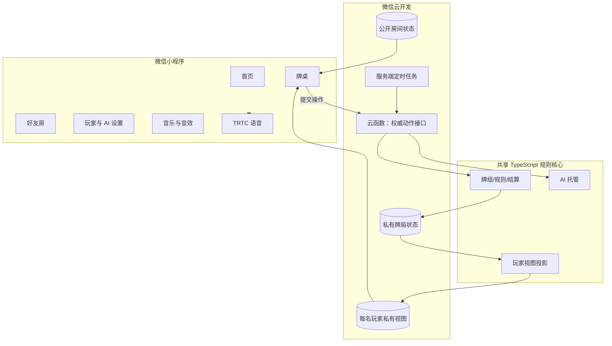
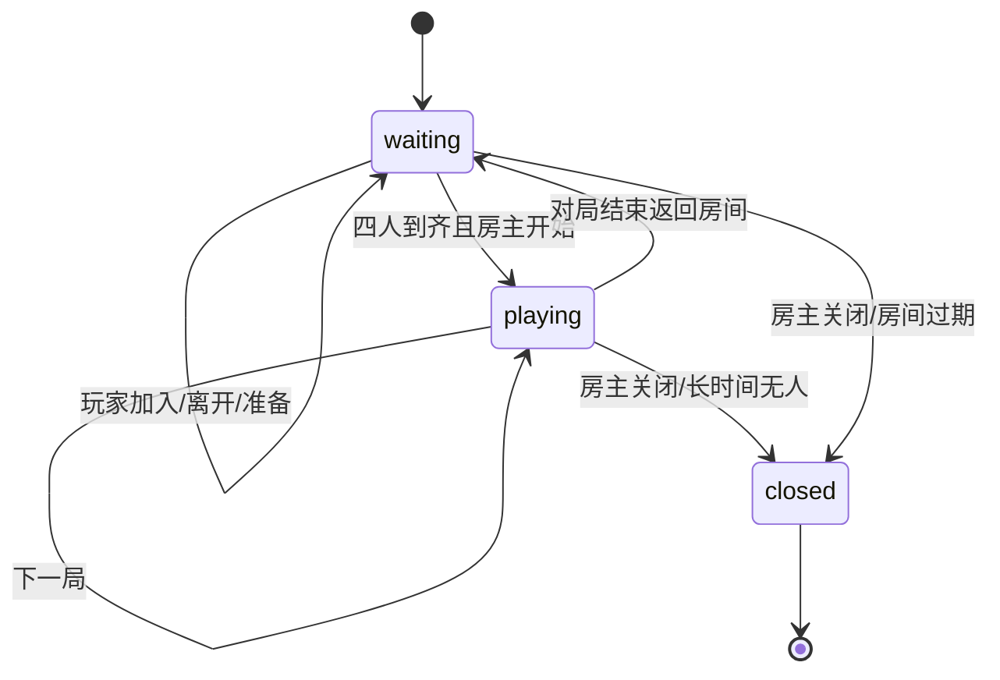
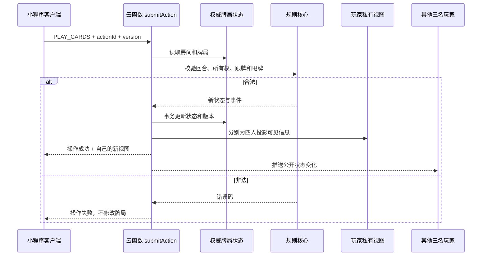

# 微信小程序四人联机开发方案

## 1. 目标

做一个微信好友房版本：

- 最多四名真人玩家。
- 一名玩家创建房间，另外三名好友通过房间号或微信分享加入。
- 四家完整进行“升级”连续对局。
- 玩家中途掉线后可以重连。
- 掉线玩家由 AI 临时托管。
- 四人在房间内进行实时语音，支持全局开麦、闭麦和说话状态。

第一版不包含：

- 公共大厅
- 随机匹配
- 旁观
- 排行榜
- 赛事
- 充值或任何赌博功能

## 2. 推荐技术方案

### 客户端

使用**微信原生小程序**：

- WXML + WXSS + TypeScript
- 不直接使用当前网页版 DOM
- 规则核心复用现有 TypeScript 模块
- 页面采用手机竖屏布局
- 音频和语音封装为 App 级单例

选择原生小程序而不是 Taro，主要原因是联机语音、麦克风权限、切后台和微信生命周期更直接。

### 服务端

第一版推荐微信云开发：

- 云函数：权威动作校验和状态变更
- 云数据库：房间、牌局、私有视图和操作日志
- 云开发实时监听：推送公开状态变化
- 定时触发器：服务端回合超时和掉线托管

如果以后并发房间明显增加，再把牌局服务迁移到独立 Node.js + WebSocket + Redis。

### 语音

优先使用腾讯云 TRTC 小程序 SDK：

- 四名玩家加入同一语音房间
- 支持全员开麦
- 单独显示麦克风状态
- 管理回声、静音和断线
- 与牌局服务分离

微信原生语音能力也可以评估，但上线前必须确认当前主体、类目和接口权限。TRTC 更便于控制房间和音质。

## 3. 总体架构



## 4. 必须遵守的信息边界

当前网页版在本地保存完整牌局，适合单机，但不能直接用于联机。

服务端必须保存：

- 完整 54 张牌
- 四家真实手牌
- 底牌
- 暗令花色
- 洗牌随机种子
- 完整出牌历史
- 操作版本号

客户端只能收到：

- 自己的手牌
- 已公开出牌
- 已公开叫主者
- 打底完成后的令花色
- 自己的暗叫信息
- 公开弃牌
- 当前出牌者、当前最大和旁家积分

任何客户端都不能直接读取其他玩家的手牌或暗令。

## 5. 仓库结构建议

```text
upgrade-card-game/
├── apps/
│   ├── web/                   当前网页版
│   └── wechat-miniprogram/    微信原生小程序
├── packages/
│   ├── game-core/             牌组、规则、状态机、结算、AI
│   └── protocol/              动作、事件、视图和错误码
├── cloudfunctions/
│   ├── createRoom/
│   ├── joinRoom/
│   ├── submitAction/
│   ├── getSnapshot/
│   └── roomTimer/
├── docs/
└── tests/
```

当前项目可以先保留网页版目录结构，第二步再迁移到 `apps/web`。不要复制一份规则代码到小程序中，否则网页端和联机端会逐渐出现规则差异。

## 6. 规则核心重构

为了在服务端运行，`GameSession` 需要从依赖内存对象的模式改成可序列化状态机。

建议接口：

```ts
createMatch(seed: number): MatchState
reduceAction(state: MatchState, action: GameAction): ActionResult
projectView(state: MatchState, viewer: PlayerId): PlayerView
getLegalActions(state: MatchState, player: PlayerId): GameAction[]
tick(state: MatchState, serverNow: number): ActionResult
```

要求：

- `MatchState` 可以完整序列化到数据库。
- 不允许闭包持有不可恢复的随机数状态。
- 所有动作带唯一 `actionId`。
- 同一个动作重复提交只能生效一次。
- 任何非法动作返回明确错误码，不修改状态。

现有 `src/game` 的牌组、牌力、甩牌、吃分、升级和 AI 可以继续复用。

## 7. 云数据库设计

### `rooms/{roomId}`

```text
roomId
status: waiting | ready | playing | closed
ownerOpenId
createdAt
updatedAt
currentMatchId
version
```

### `roomMembers/{roomId}_{openId}`

```text
roomId
openId
seat: blue1 | blue2 | red1 | red2
nickname
ready
connected
lastSeenAt
```

### `matches/{matchId}`

只允许云函数读写，保存完整真实牌局：

```text
matchId
seed
state
version
phase
turnDeadlineAt
updatedAt
```

### `playerViews/{matchId}_{openId}`

只允许对应玩家读取：

```text
viewer
version
privateHand
section
publicState
```

### `actions/{matchId}_{actionId}`

保存幂等结果和审计信息：

```text
actionId
player
type
expectedVersion
accepted
errorCode
createdAt
```

## 8. 房间流程



房间码使用六位数字，创建时在事务中检查碰撞。每名玩家只能占用一个座位，同一 `openid` 不能重复加入。

## 9. 服务端动作接口

建议只暴露一个统一入口：

```text
submitAction({
  roomId,
  matchId,
  actionId,
  expectedVersion,
  type,
  payload
})
```

动作类型：

- `CALL_TRUMP`
- `PASS_CALL`
- `RESPOND_REVOLT`
- `CHOOSE_BOTTOM_INTENT`
- `BURY_BOTTOM`
- `PLAY_CARDS`
- `TIMEOUT_PLAY`
- `CANCEL_MANAGED`

服务端处理顺序：

1. 用微信云开发上下文取得可信 `openid`。
2. 检查房间、座位和对局状态。
3. 检查 `expectedVersion`，拒绝过期操作。
4. 检查 `actionId`，保证幂等。
5. 用规则核心生成合法动作并校验。
6. 更新完整牌局。
7. 生成每名玩家的私有视图。
8. 递增版本号并提交事务。
9. 推送公开状态和新版本。

## 10. 一次出牌时序



## 11. 超时与掉线托管

服务端保存 `turnDeadlineAt`，不能依赖某一台客户端计时。

- 玩家出牌回合默认 15 秒。
- 客户端倒计时只用于展示。
- 云函数收到过期操作时拒绝。
- `roomTimer` 定期扫描到期对局。
- 到期后由服务端执行一般难度 AI 动作。
- 玩家切后台、断网或强退不会停止服务端计时。
- 玩家重连后拉取最新版本和私有视图。

断线判定建议：

- 超过 10 秒没有心跳，标记离线。
- 保留座位 2 分钟。
- 离线期间 AI 托管。
- 重连后自动取消托管。
- 超时未返回，房间可继续或由房主处理。

## 12. 语音方案

语音使用独立 TRTC 房间：

- `roomId` 经过哈希后作为 TRTC 房间标识。
- TRTC 用户 ID 使用 `openid`。
- 用户进入游戏房间后加入语音房间。
- 默认闭麦，用户点击后开麦，避免意外泄露环境声音。
- 显示“开麦、闭麦、正在说话、网络较弱、已离线”。
- 离开房间立即退出语音。
- 音乐音量在有人说话时自动降低。

安全要求：

- TRTC 密钥只在服务端生成签名。
- 客户端不能包含 SecretKey。
- 麦克风使用前必须取得用户明确授权。
- 隐私政策说明麦克风用途。

## 13. 页面与交互

建议页面：

```text
pages/
  home/          创建房间 / 加入房间
  room/          四人座位 / 准备 / 房主开始 / 语音
  game/          牌桌 / 手牌 / 出牌 / 建议
  settings/      名称、音乐、音效、麦克风
```

牌桌需要针对手机竖屏重新布局：

- 顶部显示双方级别、主家、本局级牌和令花色。
- 四名玩家紧凑分布在牌桌四边。
- 手牌区使用横向 `scroll-view`。
- 当前出牌者和当前最大者使用阵营色高亮。
- 吃分区使用可展开的底部面板。
- 详细结算使用全屏页面或底部抽屉。
- 触控目标不小于 44px。
- 适配安全区、刘海屏和不同屏幕比例。

## 14. 资源与包体

当前牌面压缩素材约 7.6MB，音频约 7.6MB。

小程序版本需要：

- 牌面继续压缩为 WebP。
- 中心图建议不超过 `384×576` 或 `512×768`。
- 音频转成小程序支持的压缩格式。
- 优先使用主包加分包。
- 不把原始 WAV 和原始 PNG 打进小程序。
- 控制主包体积，避免首次进入等待过久。

## 15. 安全与公平性

- 服务端是唯一裁判。
- 客户端只负责展示和提交动作。
- 所有随机数由服务端生成。
- 隐藏手牌和暗令不得下发到无权客户端。
- AI 托管也只使用玩家可见信息。
- 所有写操作校验 `openid`、座位、版本和动作类型。
- 操作日志保留到对局结束，用于排查争议。

## 16. 测试方案

### 规则测试

继续使用当前 Vitest 测试，并增加：

- 序列化后恢复状态。
- 重复动作幂等。
- 过期版本拒绝。
- 私有视图过滤。
- 服务端超时托管。

### 联机测试

- 四个开发者工具客户端同时操作。
- 四台真机同时操作。
- 网络切换 Wi-Fi/5G。
- 主动杀后台后重连。
- 房主掉线和退出。
- 同一玩家重复进入房间。
- 两名玩家同时提交操作。
- 语音开麦、闭麦、来电和切后台。

### 验收标准

- 四人能够连续完成至少 10 局，不需要刷新。
- 每人只能看到自己的手牌。
- 任意客户端修改代码也不能伪造其他座位操作。
- 15 秒超时由服务端接管。
- 一人断线重连后恢复到正确牌局。
- 四人语音稳定，能独立静音和显示说话状态。
- 小程序审核类目、隐私政策和麦克风说明齐全。

## 17. 开发阶段

### 阶段 A：核心重构

- 将 `GameSession` 改为可序列化状态机。
- 增加动作 ID 和版本号。
- 增加玩家视图过滤。
- 保持现有完整对局测试通过。

### 阶段 B：单机小程序

- 创建原生小程序工程。
- 完成手机牌桌、手牌、叫主、打底、出牌和结算。
- 接入压缩牌面和音频。
- 完成出牌建议、打底建议与 AI 托管。

### 阶段 C：好友房联机

- 创建/加入/准备/开始房间。
- 云函数权威动作。
- 云数据库版本控制和实时推送。
- 断线重连、心跳和服务端超时。

### 阶段 D：语音

- 接入 TRTC。
- 全局麦克风状态。
- 说话提示、静音、音量压低。
- 切后台和来电测试。

### 阶段 E：发布准备

- 微信小程序 AppID 和云开发环境。
- 类目、隐私、备案和审核材料。
- 真机测试与体验版发布。
- 正式版灰度发布。

## 18. 开发前置条件

- 微信公众平台小程序账号和 AppID
- 微信开发者工具
- 已开通的云开发环境
- 腾讯云 TRTC SDKAppID
- 已确认主体和小程序类目支持真人语音

## 19. 推荐启动顺序

先完成“可序列化规则核心 + 单机微信小程序”，再接云开发四人房，最后接语音。不要先从语音或大厅开始，否则规则状态、隐藏信息和断线重连的问题会被音频问题掩盖。
